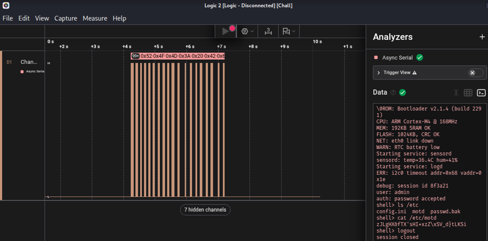
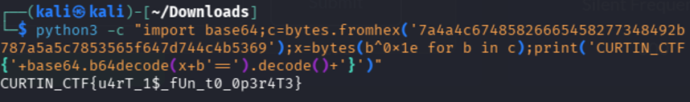
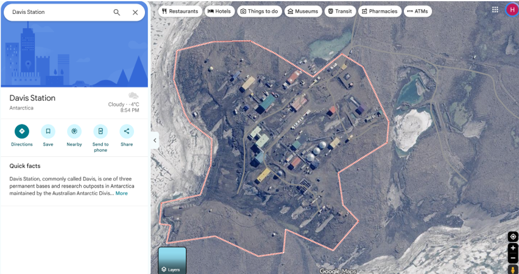
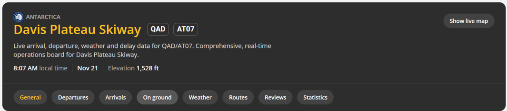
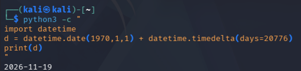
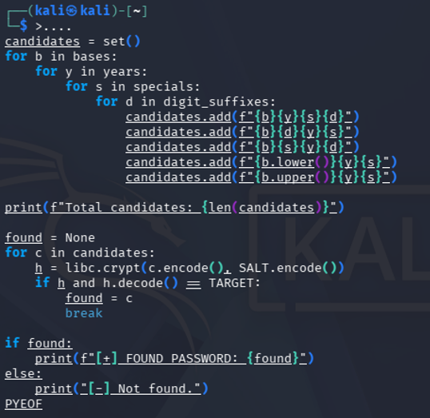

# Misc problem

下面的是本次2026CTF4(2026.11.21)中解出的Misc题目writeup

## IOT
### radio silence
题目提到智能灯泡和公司网站已关闭，先从公司的历史资料入手：BeON Home曾生产蓝牙智能灯泡，并于2018年停止运营。在FCC设备记录中查找BeON Home。记录显示，2ABLO4001是该公司的Keyfob设备，并附有内部照片。查看内部照片中的电路板丝印，可读到`BEONBT4001_Ver1.0_20160409`即为flag

### hidden flag
压缩包内有一个Chall.fc32文件。它没有常见音频文件的文件头，不能直接按WAV播放。结合.fc32扩展名，将其作为原始复数浮点IQ数据进行分析：每个复数样点由两个小端float32数值组成，分别对应I、Q分量。

先查看频谱，发现信号在约±62.5 kHz附近有明显分量。按1.25 MHz采样率假设，将信号搬移到基带，再通过低通滤波和取模得到包络。包络的高低电平可用于恢复比特。

对每100个样点划分一个比特，并从偏移41开始，对每个比特开头的20个样点求平均。以0.25为阈值判定0、1，再按高位在前的顺序每8位组合成一个字节。解码结果以0xAA开头，得到ASCII文本即为flag

### vehicle network
附件包含一份CAN总线日志drive_log.csv和对应的信号定义文件vehicle_bus.dbc。先根据DBC文件中的E2E_DataID属性和CRC注释检查报文。计算CAN数据载荷中的E2E CRC，校验参数为CRC-8 SAE J1850：多项式0x1D，初值0xFF，最终异或0xFF。计算输入为E2E_DataID的低字节、高字节，以及报文数据的前7个字节。对于CRC不匹配的报文，取“实际 CRC XOR 重新计算的CRC”作为一个字符，最后按时间戳排序拼接。按相同方法处理全部异常帧，并按时间顺序读取字符得到flag。

### fl4shdump
题目提供了一份从CURTIN-RTR路由器SPI Flash中读取的固件镜像，大小为512 KiB。先查看镜像中的可读字符串，可以找到 U-Boot 信息、启动参数和分区布局`mtdparts=spi0.0:64k(u-boot),64k(u-boot-env),192k(kernel),128k(rootfs),64k(nvram)`，按该布局，rootfs从偏移0x50000开始，长度为0x20000。该区域开头是gzip文件头`1f 8b`，因此可以导出并解压，解压后的内容是newc格式的CPIO archieve，其中包括`etc/board.conf`、`etc/provision.enc` 和 `usr/sbin/provision`。

查看usr/sbin/provision，可以看到：
  - hw_serial的SHA-256十六进制摘要的前32个字符
  - IV是BOARD_ID的MD5十六进制摘要
  - 使用AES-128-CBC解密etc/provision.enc

NVRAM位于偏移0x70000。其中的hw_serial为`CRT-K7Q2-M9XV-4HZ8-WD3N`，etc/board.conf中的BOARD_ID为`CURTIN-RTR-AC1200-r2`，所以
```python
import hashlib

serial = b"CRT-K7Q2-M9XV-4HZ8-WD3N"
board_id = b"CURTIN-RTR-AC1200-r2"

key = hashlib.sha256(serial).hexdigest()[:32]
iv = hashlib.md5(board_id).hexdigest()
```

从CPIO归档中提取etc/provision.enc，密文为`7e5403871d5908bf45daa3dcb69116ce800e0a2be767a27eb9f1fcdf57f02427151b2efad12175fe893623296da8a9b3`，openssl的aes-128-cbc模式解密即可

### two wire channel
题目提供一个逻辑分析仪导出的Capture.vcd，VCD文件记录了两路单比特信号D0和D1，时间单位为1 us。观察波形可见，D0持续产生规则时钟脉冲，D1则在时钟高电平期间保持数据，并在时钟高电平时出现起始和停止变化。因此将D0视为SCL、D1视为SDA，按I²C的方式解码：在SCL上升沿采样SDA，每8位组成一个字节，第9位为ACK。

第一笔事务的数据以`78 00 AE D5 80 A8 3F D3 00 40 8D 14 20 00 AF`开头，其中0x78与I²C设备地址0x3C的写地址字节相符，后面的0x00是控制字节。这个命令序列与SSD1306类设备的I²C写入格式相符：0x00用于命令流，0x40用于数据流。后续事务以`78 40`开头。去掉地址和控制字节后，可读出提示文本`Here is the piece of the text you wanted:`.提示后面的数据是分段传输的十六进制文本`4932635f6730545f 556e6c3334356833 44`解码为ascii获得flag

### silent pulse
题目给了一个vault_dump.bin，来自ESP32（Arduino 核心，ESP-IDF v5.4.1）的4MB原始闪存文件。分区表显示：nvs、otadata、app0/app1（app1为空白）、spiffs（空）和coredump。其中活动固件（app0）是一个名为“ESP32 VAULT v2.0”的自定义草图，包含以下嵌入字符串：

```text
Enter PIN to unlock: / A fresh PIN was generated for this session.

[+] Access granted. / [+] Vault checksum: 0x%08X

[+] Flag is sealed in the vault. You can't read it from here...

[!] Too many attempts. Vault re-keyed. Locked for 5s.
```

ESP32的NVS（非易失性存储）是一种专有键值格式：固定的4 KB页面、32字节条目、通过由特殊条目声明的索引解析的命名空间。在这个环境下没有主流现成的解析器，所以用Python写一个小型解析器，它会逐页游走，读取条目头（命名空间 、类型 、跨度 、键 ），并重建多项数据块。在解析 nvs 分区（0x9000–0xE000）时，在例行的 WiFi 凭据历史（包括多个旧 SSID，包括 ESP32-RFID-Cloner）中，出现了一个名为 rfid_data 的命名空间，存储两条存储的卡片记录：
| Key    | 关键Value                        |
| ------ | -------------------------------- |
| 0_uid	 | F67C76A5                         |
| 0_dump | 1024-byte Mifare Classic 1K dump |
| 1_uid	 | EB258459                         |
| 1_dump | 1024-byte Mifare Classic 1K dump |

我们尝试拼接两个uid发现确实是flag内容

### captured whispers （author tan）
通过logic 2分析，发现Data区有/etc/motd下一串乱码疑似密文


爆破解密得到flag


## Stegno
### fsociety
一个jpeg文件，检查基本信息（file、exiftool、xxd）看到假的flag讲metadata不是flag，继续用`steghide info`检查jpeg文件，发现需要输入密码。可以用`stegseek`，找到原始隐藏文件名flag.txt获得flag

### whiterose
将音频拖到分析器看出频谱形成`key: wh1t3r0s3`，利用steghide检测发现音频中存在加密的flag.txt，利用key得到flag即可

### nothern lights
题目给了一个Northern-lights.jpg，用`stegseek --seed`发现存在stegide，接着尝试使用与“airplane company”有关的wordlist词表，输入后获得了一个mp3数据，但是无法识别，发现是反过来的，ffmpeg修复后获得正确音频，听出flag

### space hides（author：zheng）
先用Spectral Analyzer看AUDIO.WAV频谱，根据特征判断出频谱信号SSTV，使用SSTV decoder解码成图片获得隐藏1337_H4X0R.EXE，即可得到flag

## OSINT
### Pinpoint（author：tan）
南极洲戴维斯站（Davis Station）的全球Plus Code（主要编码）和地区代码拼接`PlusCode_LoCode`


### Pinpoint2（author：tan）
找过去的方式，搜索戴维斯站附近的机场，找到了Davis Plateau Skiway。这处设施的代码：IATA代码QAD，ICAO代码AT07，拼接即可得到flag


## Misc
### level challenge
1. Misc 1: nc连接后直接搜索本地文件即可看到flag<br>
2. Misc 2: nc连接后看到.bashrc，cat后最后一行显示flag<br>
3. Misc 3: nc连接后找到flag文件，发现当前用户没有权限阅读需要切换到user42，且当前存在组隔离，其中user42和user35同ctf组。尝试提权办法，直接su user35发现切换成功可以阅读flag<br>
4. Misc 4: nc连接后发现flag文件在一个/flag/flag下面，但是权限问题无法访问，查找其他有权限的文件，找到一个/print/print可以无视权限直接打印flag文件出来<br>

### Password Recovery （author：tan）
nc连接查找shadow直接发现开头bob的hash string，根据题目提示写好脚本爆破即可

