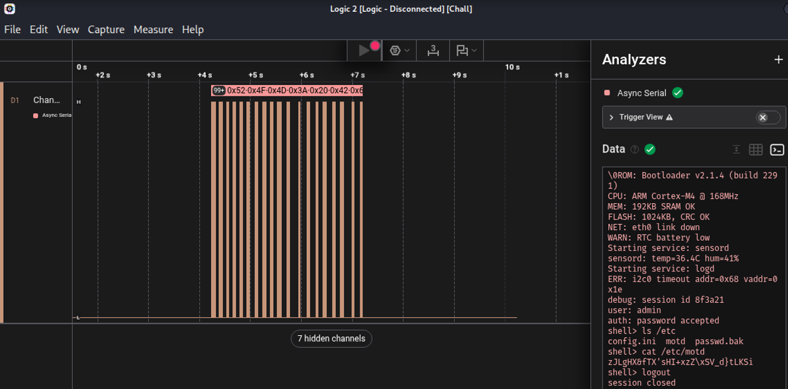
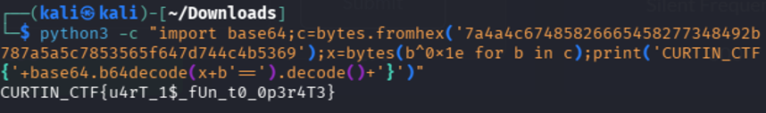
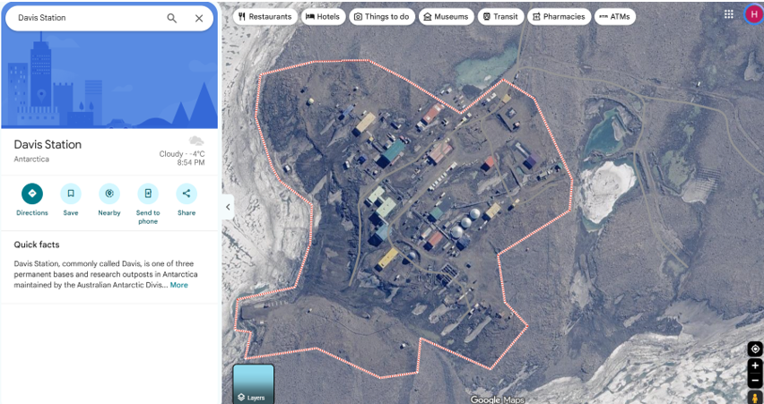
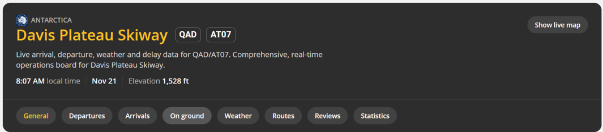
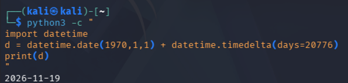
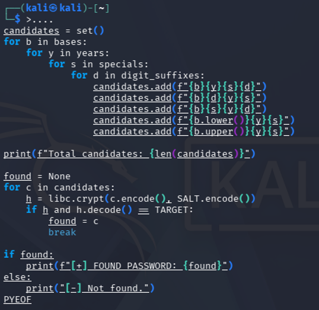

# Miscellaneous Challenge Writeups

Writeups for the Misc challenges solved during Curtin CTF4 2026 on 2026-11-21.

## IOT
### radio silence
The challenge mentions a smart light bulb and a company website that has shut down. Research the company's history: BeON Home produced Bluetooth smart bulbs and ceased operations in 2018. Search the FCC equipment records for BeON Home. The record identifies `2ABLO4001` as the company's Keyfob device and includes internal photos. The circuit-board marking in one photo reads `BEONBT4001_Ver1.0_20160409`, which is the flag.

### hidden flag
The archive contains a `Chall.fc32` file with no common audio-file signature, so it cannot be played directly as a WAV. Based on the `.fc32` extension, treat it as raw complex floating-point IQ data. Each complex sample consists of two little-endian float32 values, the I and Q components.

Inspect the spectrum and find prominent components near ±62.5 kHz. Assuming a sample rate of 1.25 MHz, shift the signal to baseband, then apply a low-pass filter and take the magnitude to obtain its envelope. The high and low levels of the envelope represent the bits.

Divide the samples into 100-sample bit periods. Starting at offset 41, average the first 20 samples of each bit. Use 0.25 as the threshold to classify each bit as 0 or 1, then combine each group of eight bits into a byte, most significant bit first. The decoded data begins with `0xAA`; interpreting it as ASCII yields the flag.

### vehicle network
The attachments are a CAN log, `drive_log.csv`, and its signal definition file, `vehicle_bus.dbc`. Use the DBC file's `E2E_DataID` attributes and CRC comments to validate the messages. Calculate the E2E CRC over the low byte and high byte of `E2E_DataID`, followed by the first seven bytes of the message payload. The CRC parameters are CRC-8 SAE J1850: polynomial `0x1D`, initial value `0xFF`, and final XOR `0xFF`.

For each frame whose CRC does not match, take the actual CRC XOR the recalculated CRC as one character. Sort these characters by timestamp and concatenate them. Processing all invalid frames in timestamp order yields the flag.

### fl4shdump
The challenge provides a 512 KiB firmware image read from a CURTIN-RTR router's SPI flash. Readable strings reveal U-Boot information, boot parameters, and this partition layout: `mtdparts=spi0.0:64k(u-boot),64k(u-boot-env),192k(kernel),128k(rootfs),64k(nvram)`. The rootfs begins at offset `0x50000` and is `0x20000` bytes long. It starts with the gzip signature `1f 8b`; extract and decompress it to get a `newc` CPIO archive containing `etc/board.conf`, `etc/provision.enc`, and `usr/sbin/provision`.

Inspect `usr/sbin/provision` to find that it:
- Uses the first 32 hexadecimal characters of the SHA-256 digest of `hw_serial` as the key.
- Uses the MD5 digest of `BOARD_ID` as the IV.
- Decrypts `etc/provision.enc` with AES-128-CBC.

The NVRAM at offset `0x70000` contains `hw_serial` = `CRT-K7Q2-M9XV-4HZ8-WD3N`, and `etc/board.conf` contains `BOARD_ID` = `CURTIN-RTR-AC1200-r2`:
```python
import hashlib

serial = b"CRT-K7Q2-M9XV-4HZ8-WD3N"
board_id = b"CURTIN-RTR-AC1200-r2"

key = hashlib.sha256(serial).hexdigest()[:32]
iv = hashlib.md5(board_id).hexdigest()
```

Extract `etc/provision.enc` from the CPIO archive. Its ciphertext is `7e5403871d5908bf45daa3dcb69116ce800e0a2be767a27eb9f1fcdf57f02427151b2efad12175fe893623296da8a9b3`. Decrypt it with OpenSSL in AES-128-CBC mode.

### two wire channel
The challenge provides a logic-analyzer export, `Capture.vcd`, containing two one-bit signals, D0 and D1, with a time unit of 1 us. D0 generates regular clock pulses. D1 holds data while the clock is high and changes for start and stop conditions while the clock is high. Treat D0 as SCL and D1 as SDA, then decode the signals as I²C: sample SDA on each SCL rising edge, group each eight bits into a byte, and treat the ninth bit as the ACK.

The first transaction starts with `78 00 AE D5 80 A8 3F D3 00 40 8D 14 20 00 AF`. Here, `0x78` corresponds to the I²C write address for device `0x3C`, followed by the control byte `0x00`. This sequence matches the I²C write format used by SSD1306-class devices: `0x00` indicates a command stream and `0x40` a data stream. Later transactions begin with `78 40`. After removing the address and control bytes, the readable prompt is `Here is the piece of the text you wanted:`. The following data is split across transactions as hexadecimal text: `4932635f6730545f 556e6c3334356833 44`. Decode it as ASCII to obtain the flag.

### silent pulse
The challenge provides `vault_dump.bin`, a 4 MB raw flash dump from an ESP32 running the Arduino core and ESP-IDF v5.4.1. Its partition table lists NVS, otadata, app0/app1 (app1 is blank), SPIFFS (empty), and a coredump. The active firmware in app0 is a custom sketch named `ESP32 VAULT v2.0`, containing these strings:

```text
Enter PIN to unlock: / A fresh PIN was generated for this session.

[+] Access granted. / [+] Vault checksum: 0x%08X

[+] Flag is sealed in the vault. You can't read it from here...

[!] Too many attempts. Vault re-keyed. Locked for 5s.
```

ESP32 NVS uses a proprietary key-value format: fixed 4 KB pages, 32-byte entries, and namespaces resolved through indices declared by special entries. Since no common parser was available in this environment, a small Python parser was written to walk the pages, read entry headers (namespace, type, span, and key), and reconstruct multi-entry values. Parsing the NVS partition (`0x9000`-`0xE000`) revealed the `rfid_data` namespace among the usual Wi-Fi credential history, which included several old SSIDs such as `ESP32-RFID-Cloner`. It contained two stored card records:

| Key | Relevant value |
| --- | --- |
| `0_uid` | `F67C76A5` |
| `0_dump` | 1024-byte Mifare Classic 1K dump |
| `1_uid` | `EB258459` |
| `1_dump` | 1024-byte Mifare Classic 1K dump |

Concatenating the two UIDs produces the flag content.

### captured whispers (author: tan)
Analysis in Logic 2 shows a string that looks encrypted after `/etc/motd` in the Data area.


Brute-force decryption recovers the flag.


## Stegno
### fsociety
Inspect the JPEG's basic metadata with tools such as `file`, `exiftool`, and `xxd`. A message says the flag is in the metadata, but it is a decoy. Check the file with `steghide info` and find that a password is required. Run `stegseek` to recover the hidden file `flag.txt`, which contains the flag.

### whiterose
View the audio spectrum in an analyzer to find `key: wh1t3r0s3`. Use steghide to confirm that the audio contains an encrypted `flag.txt`, then use the key to extract the flag.

### nothern lights
The challenge provides `Northern-lights.jpg`. Run `steghide --seed` to find that steghide data is present. Then try a wordlist related to an "airplane company". The recovered data is an MP3, but it is not recognized at first. The audio is reversed; fix it with ffmpeg and listen to recover the flag.

### space hides (author: zheng)
Inspect the spectrum of `AUDIO.WAV` with Spectral Analyzer. Its pattern indicates SSTV. Decode it to an image with an SSTV decoder to reveal `1337_H4X0R.EXE`, which leads to the flag.

## OSINT
### Pinpoint (author: tan)
Concatenate the global Plus Code (main code) for Davis Station in Antarctica with its local code: `PlusCode_LoCode`.


### Pinpoint2 (author: tan)
Search for an airport near Davis Station. The nearby Davis Plateau Skiway has IATA code `QAD` and ICAO code `AT07`; concatenate the codes to get the flag.


## Misc
### level challenge
1. Misc 1: Connect with `nc` and search the local files to find the flag.
2. Misc 2: Connect with `nc` and inspect `.bashrc`; the final line contains the flag.
3. Misc 3: Connect with `nc` and locate the flag file. The current user cannot read it and must switch to `user42`. Group isolation is in place, and both `user42` and `user35` belong to the `ctf` group. Switching to `user35` with `su user35` succeeds and allows the flag to be read.
4. Misc 4: Connect with `nc`. The flag file is at `/flag/flag`, but permissions prevent direct access. Search for another readable executable and find `/print/print`, which prints the flag despite the file permissions.

### Password Recovery (author: tan)
Connect with `nc` and inspect `shadow`. The hash for `bob` appears near the beginning. Write a cracking script based on the challenge hint.


