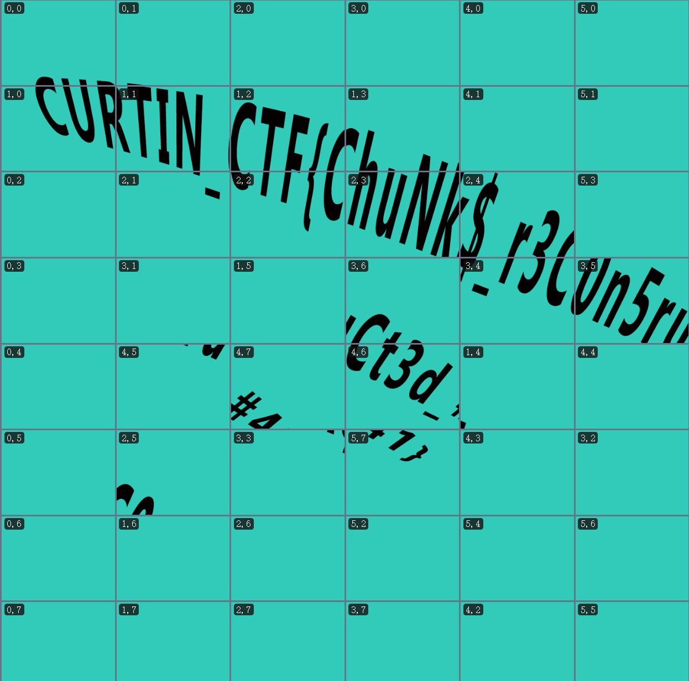

# Forensics Challenge Writeups

Writeups for the forensics challenges solved during Curtin CTF4 2026 on 2026-11-21.

## lost
The PCAPNG file contains 48 custom UDP TILE datagrams. Each datagram includes x/y coordinates and the length of a PNG tile. The tiles form a 6-by-8 grid, with each tile measuring 240 by 180 pixels.

Reconstruct the image, split it into tiles, and drag the tiles into place to recover the flag.


## unknown
The supplied `Chall.dat` file has no recognizable file signature at its beginning. Inspecting its end reveals a reversed PNG signature. Reverse the bytes of the entire file to recover a PNG containing the flag.


## unknown2
The file header resembles the RAR5 signature. Replace the opening bytes with `52 61 72 21`, then open the archive. It requires a password; a weak-password brute-force attempt finds `.loveme.`. Extract `store.db`, identify it as SQLite, dump its contents, and search for the flag.

## sector zero
The challenge provides a `.001` disk image. Opening it in Autopsy shows encrypted sectors. A weak-password brute-force attempt finds `purple69`.

Mount the image and use `bdemount` to inspect the decrypted NTFS volume. Examine the MFT and LogFile transaction log. They show a shortcut file created and modified after BitLocker was enabled: `/Links/notepad++ - Shortcut.lnk`. In the shortcut's `StringData` area, the `WORKING_DIR` field is `C:\Program Files\Notepad++`. The following `COMMAND_LINE_ARGUMENTS` field contains a hexadecimal string at offset `0x58c25a`, with length `0x002c` (44 characters) in UTF-16LE. Decode it to obtain the flag.

## digital footprints
Locate the suspicious program `SOMETHING.EXE` in the Prefetch files and inspect `SOMETHING.EXE-0A0B02BB.pf`. The first nonzero run-time entry is the most recent run. Decoding it gives `2026-10-26 17:36:40.931544 UTC`. As instructed by the challenge, add 5 hours and 30 minutes to convert UTC to IST: `2026-10-26 23:06:40.931544`. FILETIME stores UTC; use whole-second precision as required by the flag format.

## dark army
The snapshot contains Windows user files, browser data, a KeePass database, and the SAM and SYSTEM registry hives. First inspect `passwords_backup.txt` on the desktop. It contains VPN, Jenkins, and SMB credentials, along with two flag-shaped strings labelled as an old password and an unused recovery seed; these are decoys. Chrome's Login Data contains a panel login for `mr_robot`, but its password is protected with DPAPI. Parse the SAM and SYSTEM hives to find the local account `whiterose` and recover its NT hash. John then recovers the account password `trustno1`.

Use the recovered password and account SID to decrypt the DPAPI master key in the Protect directory, then decrypt the key stored in Chrome's Local State. Read and decrypt the `darkarmy.onion.ws/panel` record from Login Data to recover `mr_robot / wh1t3r0s3-m1nd-p4l4c4`. Use that password to open `panel.kdbx` and inspect the Command Panel entry for the flag.

## echoes of silent past
The supplied `.bin` file is a 4 MB ESP32 flash dump. Extract the application firmware from flash offset `0x10000`. Use the load addresses in the image segment headers to map its code and data, then analyze it with an Xtensa disassembler.

Strings include `Access granted`, `Vault checksum`, and `Flag is sealed in the vault`. Follow their references to `main`: the program checks a four-digit PIN generated for the current session, then restores several data blocks, assembles them in a buffer, calculates an FNV-1a checksum, prints it, and clears the buffer. The PIN only gates entry to this branch. The constants needed to restore the data are all present in the firmware, so the reconstruction logic can be analyzed directly.

At application firmware offset `0x8c9c`, find a five-entry table. Each entry is 8 bytes and records a data address, data length, destination offset, transform mode, and padding byte. A four-byte repeating key, `5A 13 C7 2E`, is stored at offset `0x8cc4`.

Reading the branches reveals five restoration modes. Here, `i` is the index within a data block, starting at zero; `n` is that block's length; and `ROR8` is an 8-bit rotate right:
```text
mode 0:
out[i] = data[i] XOR key[i % 4]

mode 1:
out[i] = (data[i] + 239 * (i + 1)) AND 255

mode 2:
out[i] = data[i] XOR ((7 * i + 3) AND 255)

mode 3:
out[i] = ROR8(data[i], 3) XOR 0x6b

mode 4:
out[i] = data[n - 1 - i] XOR 0x42
```

Restore each block at the destination offset from the table rather than concatenating the entries in table order. The recovered parts are:
```text
Offset  Recovered data
0       GMSFALJT
8       GJPTCNK7
16      OYZVE6K7
24      OAYHOM2S
32      MZKWY
```

Concatenate them to get `GMSFALJTGJPTCNK7OYZVE6K7OAYHOM2SMZKWY`, add the required `=` padding, and decode it as Base32 to obtain the flag.
