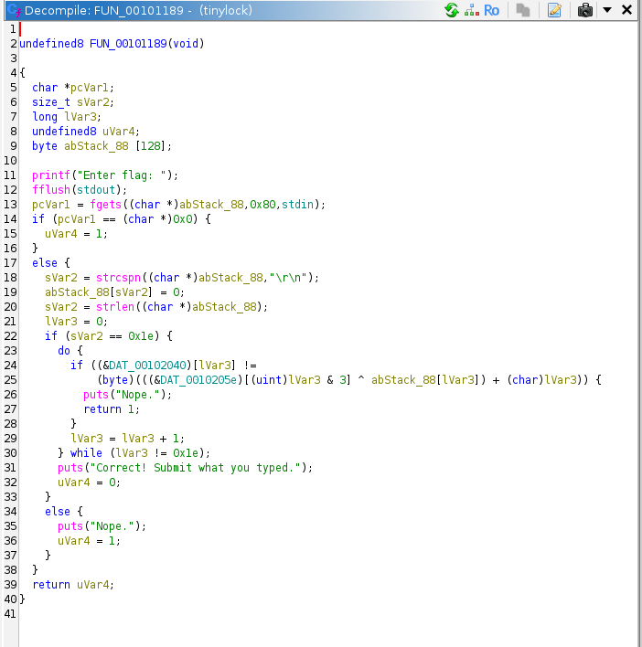
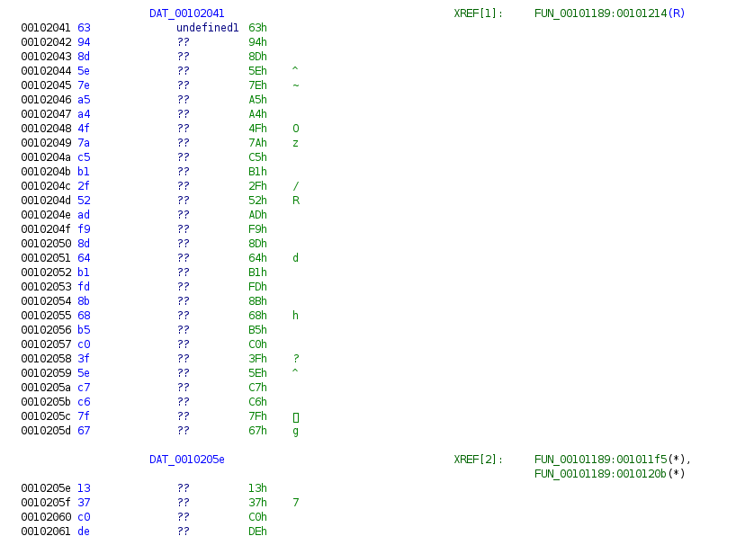
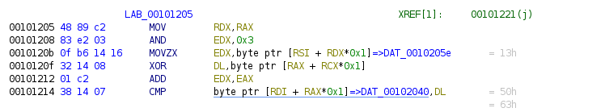
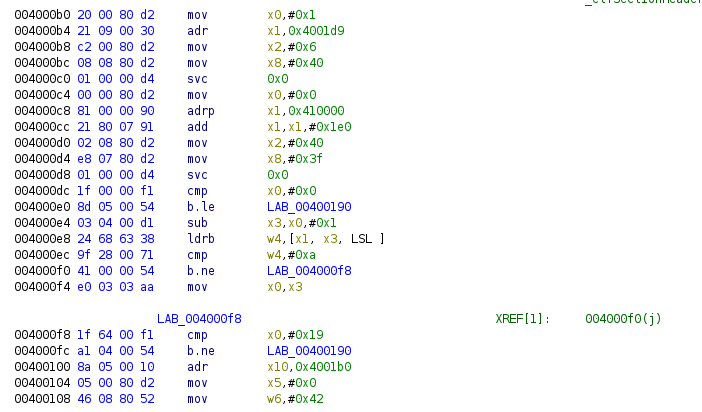
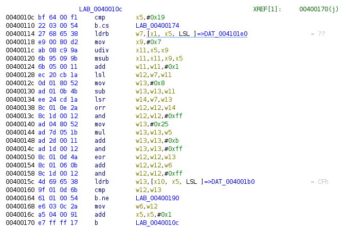
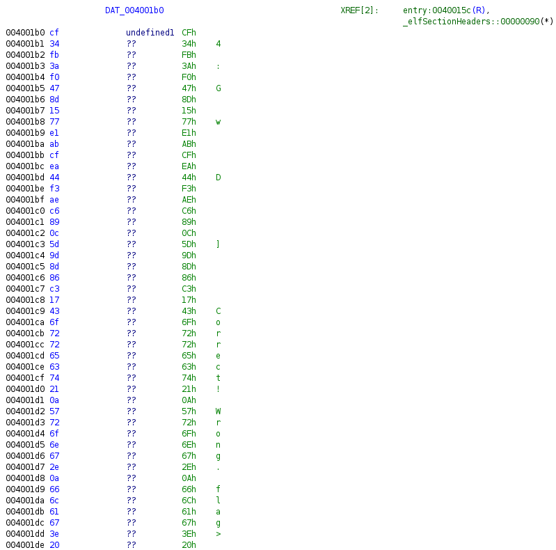
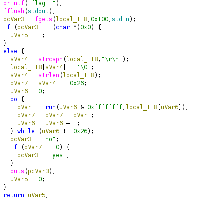
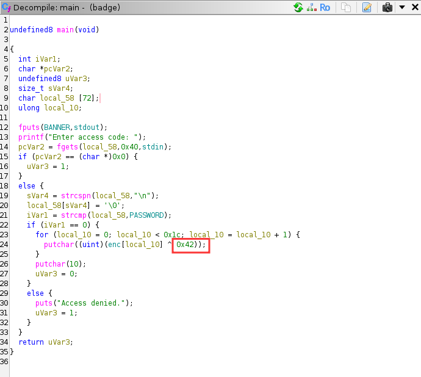
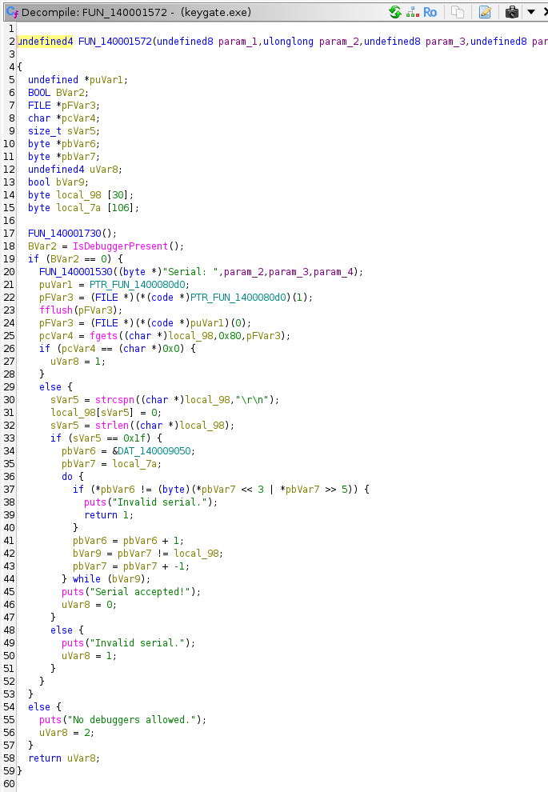

# Reverse Engineering Challenge Writeups

Writeups for the reverse-engineering challenges solved during Curtin CTF4 2026 on 2026-11-21.

## tinylock
The file is an x86-64 ELF executable. Its imported functions include `fgets`, `strlen`, `strcspn`, and `printf`, and it reads and checks one line of input.

Inspect the validation code in a reverse-engineering tool. The program removes the trailing newline, then uses `strlen` to require a length of `0x1e` (30 bytes). It compares the input byte by byte. Any mismatch prints `Nope.`; a full match prints the success message.


The four bytes at `rsi`, `13 37 C0 DE`, are the key. `rdi` points to the target data area, which is produced by:


```text
target[i] = ((input[i] XOR key[i % 4]) + i) mod 256
```

Invert the expression to recover the original flag:
```text
input[i] = ((target[i] - i) mod 256) XOR key[i % 4]
```


## asmaze
The file is an ARM AArch64 ELF executable.

The decompilation at the entry point is incomplete, so inspect the assembly directly.


```C
n = read(0, buffer, 64);
if (n <= 0)
    fail();

if (buffer[n - 1] == '\n')
    n--;

if (n != 25)
    fail();
```

The byte-validation formula is:
```text
r     = (i % 7) + 1
k     = (0x25 * i + 0x0b) & 0xff
value = (ROL8(input[i], r) XOR k + previous) & 0xff
```


The following data contains only 25 bytes of interest; the remaining bytes are strings used by the program.


Invert the operations to recover the flag:
```text
x = ((t[i] - v[i-1]) & 0xff) XOR k
c[i] = ROR8(x, r)
v[i] = t[i]
```

## droidvault
The challenge is an Android APK. In `classes.dex`, find `com.curtin.droidvault.MainActivity`. Open `classes.dex`, locate `check(String)`, and inspect the class initializer, `<clinit>`, to find the 32-integer `VAULT` array used for validation.

Reading the Dalvik instructions for `check` shows that the program first compares the input length with the array length, then loops over the input characters. It XORs each character and compares the result with the corresponding `VAULT[i]` value. Any mismatch returns failure; if every character matches, it returns success.

The formula and its inverse are:
```text
value = input[i] XOR 90 XOR (i AND 15)

input[i] = VAULT[i] XOR 90 XOR (i AND 15)
```

## thousandcuts
The file is an x86-64 ELF. Analysis of `main` shows that the input buffer is cleared first. If reading input fails, the program exits with status 1. After excluding a trailing newline, the input must be 38 bytes. A failed check returns 1 (true) from the flag-check routine. If those checks pass, the program validates indices 0 through 37 one at a time.

The `run` method checks the byte for a given index. Its disassembly shows that the index selects an operation in the program, and the corresponding input byte is passed to that operation. Each operation checks whether its byte matches the expected value. The program prints `yes` only if all 38 checks pass; otherwise, it prints `no`. With this logic understood, a script can brute-force each byte in turn.


## wasmgate
The challenge provides a WebAssembly file and an `index.html`. The HTML writes the input into WebAssembly memory and calls `check(256, input_length)`.

The WebAssembly code first checks that the input length is 28. It then sets `state = 92` and processes each byte:
```python
value = ((input[i] * 7 + i) & 255) XOR memory[i % 5] XOR state

if value != memory[16 + i]:
    error

state = value
```

If every byte matches, the check succeeds. To reverse it, use the data already in memory: the first 5 bytes are the repeating key, and the 28 bytes starting at offset 16 are the target sequence. The multiplicative inverse of 7 modulo 256 is 183, so:
```python
input[i] = (((target[i] XOR key[i % 5] XOR state) - i) * 183) & 255

state = target[i]
```

Pass the recovered output back to `check` to verify it and obtain the flag.

## speedrun
The file is an x86-64 ELF executable. It requires 150 questions to be answered within 2 seconds each. Every round displays an encoded string and asks for the decoded original. The main routine uses `fgets` to read each answer, compares it with `strcmp`, and sets a two-second `alarm(2)` for every round.

There are four encodings:
- `HEX`: decode hexadecimal.
- `REV`: reverse the string.
- `ROT13`: apply ROT13 decoding.
- `B64`: decode Base64.

The script approach is to read quickly from a child-process pipe and detect `>`, parse the encoding name and string with a regular expression, decode it, then write the answer to standard input and flush.

## all safe badge
The file is an x86-64 ELF executable. Readable strings from `strings`, together with the challenge hint, suggest `m1n1t3l` as a possible access code.

Reverse the program to confirm that it reads input, removes the newline, and compares the result with `PASSWORD`. On a match, it XORs a data block byte by byte with `0x42` and prints the result. Instead, locate that data block and apply the XOR directly to recover the output.


As a simpler option, run the binary and enter `m1n1t3l` to print the flag.

## keygate
The file is a PE32+ x86-64 executable.

The main routine requires a serial number of length `0x1F` (31 bytes). During validation, it rotates each input character left by 3 bits (`rol al, 3`) and compares it with a hidden byte. The comparison walks backward through the input. Find the hidden bytes in the `DATA` associated with line 34 of the main routine, rotate each byte right by 3 to reverse the transformation, then reverse the sequence to recover the serial:
```python
decoded = bytes(((b >> 3) | ((b << 5) & 0xFF)) for b in data)[::-1]
```



## flutter vault
This is an Android APK. Since the challenge uses Flutter, its Dart code is ahead-of-time compiled into `lib/arm64-v8a/libapp.so`, so focus on that file.

Use AOTopsy to inspect the ARM64 assembly in `libapp.so`. The validation function first checks for the `CURTIN_CTF{` prefix and `}` suffix, and requires the content between them to be 22 bytes.

The check uses an LCG byte stream initialized with `0x1337`, then XORs each input byte with the stream. Starting at the second byte, it adds three times the previous transformed byte to the current byte. Finally, it compares the result with a constant table in the order `(i * 5) mod 22`. Extract the constants from the Dart snapshot.
```python
state = 0x1337
state = (state * 0x41c64e6d + 0x3039) & 0x7fffffff
x[i] = input[i] XOR ((state >> 16) & 0xff)

y[0] = x[0]
y[i] = (x[i] + 3 * y[i - 1]) mod 256

table[i] = y[(i * 5) mod 22]
```

To recover the input, place the constants back into the order used by the check, reverse the recurrence, and then reverse the XOR:
```python
y[(i * 5) mod 22] = table[i]
x[0] = y[0]
x[i] = (y[i] - 3 * y[i - 1]) mod 256
input[i] = x[i] XOR ((state >> 16) & 0xff)
```

## bolt hole
This is an Android APK with package name `com.bolthole.vault`. Use Ghidra to inspect the validation and decryption logic in the DEX bytecode. Extract `classes3.dex` and `classes4.dex` from the APK, import them into Ghidra, then locate:
- `com.bolthole.vault.security.PinEvaluator.validate(String)`, which checks the PIN.
- `com.bolthole.vault.security.VaultCipher.releasePayload(Context, String)`, which decrypts the resource data using the PIN.
- `com.bolthole.vault.MainActivity.onCreate$lambda$0(...)`, which shows that the submitted PIN is passed to those methods.

`PinEvaluator.<clinit>` contains this validation array:
```text
CHECKSUM = [184, 20, 129, 94, 50, 28]
```

`validate` requires a six-digit PIN and applies this calculation to each digit `d`, where `i` is its zero-based position:
```text
((d * 17 + 43) XOR (i * 29 + 11)) AND 255
```

Each result must equal `CHECKSUM[i]`. Solving each position gives PIN `819125`.

`VaultCipher.releasePayload` reads a mask from the APK resource array `config_telemetry_masks`. Decode the APK with apktool to inspect the resource. Calculate the PIN's SHA-256 digest, then XOR each byte to restore the data:
```text
plain[i] = mask[i] XOR SHA256(UTF8(PIN))[i mod 32] XOR ((i * 13 + 7) AND 255)
```

Decrypt the resulting Base64-encoded string with the PIN, then decode it to get the flag.

## darkarmydropper
The file is an x86-64 ELF. `strings` reveals a dropper key and a `payload sealed` message.

The program calculates SHA-256 for the supplied key and compares it with a digest stored in `.rodata`. A mismatch prints `payload sealed`. This check only controls whether the decode branch is entered; the data and parameters needed for decoding can still be extracted statically from the file.

After the check passes, the program reads 37 bytes of ciphertext from `.data` at address `0x4060`, generates an LCG byte stream initialized with `0x1337`, and XORs the bytes. It updates `state` first on every iteration, then uses the high byte in the XOR:
```text
state = (state * 0x41c64e6d + 0x3039) mod 2^32
plain[i] = cipher[i] XOR ((state >> 16) AND 0xff)
```

## notenest
The relevant logic is in `classes2.dex`. Expand `com.notenest -> DiagnosticsActivity` and inspect `<clinit>`, `decodeHex`, and `onCreate`.
- In `<clinit>`, find the five Base64 strings in `ENCODED_KEYS`. Copy and Base64-decode them to get resource names such as `sync_batch_token`.
- In `onCreate`, the loop Base64-decodes each key, calls `getIdentifier(name, "string", pkg)`, passes the result to `getString`, calls `decodeHex`, and appends the output.
- In `decodeHex`, the string is processed two characters at a time. Each pair is passed to `parseInt(..., 16)` and converted to a character.

Read the five values in the array's order, decode each from hexadecimal, and concatenate them to obtain the flag.
