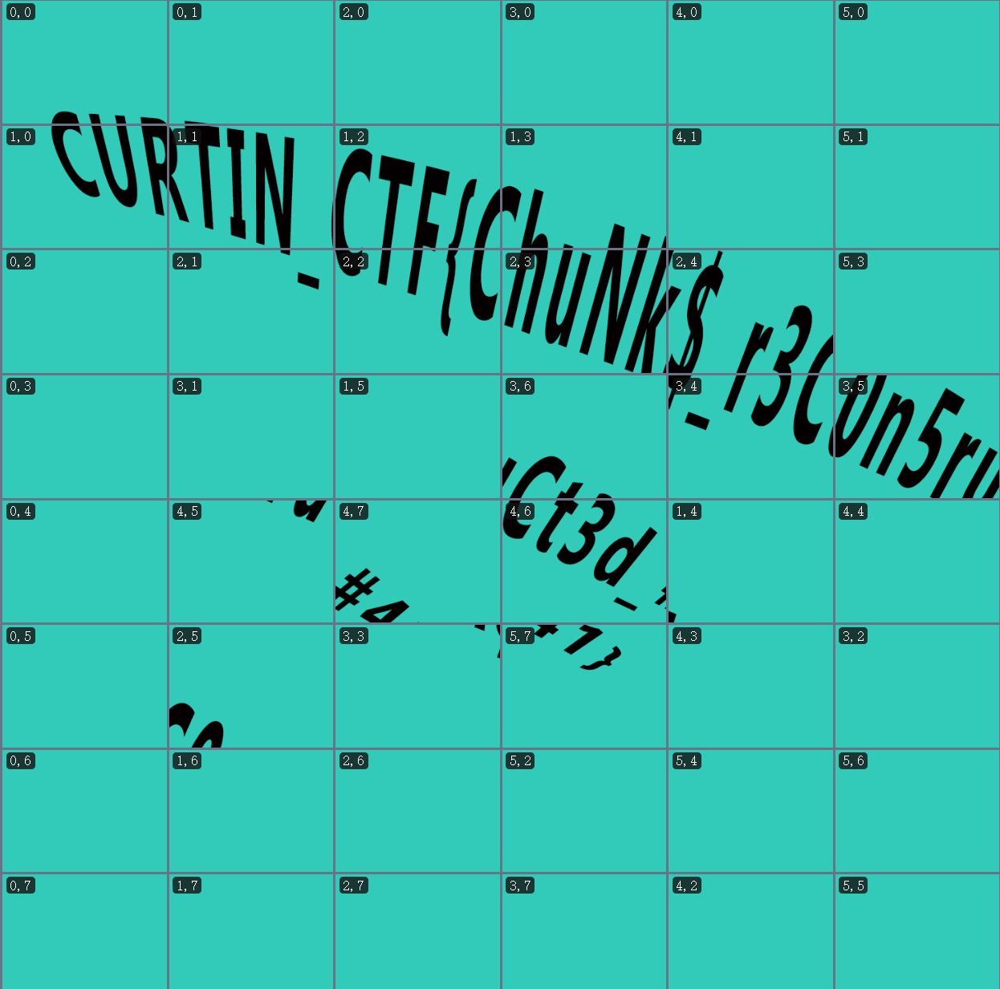

# forensics problem

下面的是本次2026CTF4(2026.11.21)中解出的forensics题目writeup

## lost
pcapng里出现了一堆神秘udp报文，有48个自定义TILE数据报。每个数据报带有x/y坐标和一个PNG图块长度；拼出的图块组成6×8网格，每块都是240×180像素。

还原图片后，分割图片，进行拖拽拼图恢复即可得到flag


## unknown
获得一个Chall.dat，检查其文件头无法发现格式签名，尝试查看末尾，发现为png的反转，所以反转整个文件字节获得png文件，得到flag


## unknown2
检查文件头发现与rar5的签名及其相似，因此开头替换为`52 61 72 21`，打开发现需要密码，直接弱口令爆破可以得到密码`.loveme.`，解压得到store.db文件，检查发现为sqlite，选择直接dump出所有内容后快速搜索获得flag

## sector zero
题目提供一个.001镜像文件，用autopsy打开看到存在扇区被加密，尝试弱口令爆破得到密码`purple69`。

挂载并用`bdemount`分析解密后的NTFS卷，检查MFT和LogFile事务日志，看到开启BitLocker后新建并修改的快捷方式文件`/Links/notepad++ - Shortcut.lnk`。找到在快捷方式的`StringData`区域，`WORKING_DIR`字段为`C:\Program Files\Notepad++`，紧随其后的`COMMAND_LINE_ARGUMENTS`字段（偏移`0x58c25a`，长度`0x002c`=44字符，UTF-16LE 编码）藏有一段十六进制字符串，解码可得flag

## digital footprints
Prefetch文件中定位到可疑程序SOMETHING.EXE，并读取对应的SOMETHING.EXE-0A0B02BB.pf。记录中的第一条非零运行时间是最近一次运行时间；解码后为2026-10-26 17:36:40.931544 UTC根据题目提示将UTC加上5小时30分钟，换算为IST：2026-10-26 23:06:40.931544。FILETIME以UTC记录，按旗标格式取整到秒，可得flag

## dark army
题目提供一个包含Windows用户文件、浏览器数据、KeePass数据库以及SAM、SYSTEM注册表hive的快照。先查看桌面上的passwords_backup.txt，其中有VPN、Jenkins、SMB凭据，也有两条标注为旧密码和未使用恢复种子的flag格式字符串，均为干扰项。Chrome 的 Login Data 中有 mr_robot 的面板登录记录，但密码经过 DPAPI 保护。因此看到本地账户，解析 SAM 与SYSTEM hive，定位账户`whiterose`，得到其NT哈希。接着john爆破获得账户密码`trustno1`

用恢复出的密码和账户SID解开Protect目录中的DPAPI主密钥，再解开Chrome Local State里的加密密钥。随后从Login Data读取`darkarmy.onion.ws/panel`记录并解密，获得账号密码`mr_robot / wh1t3r0s3-m1nd-p4l4c3`。最后用这个密码打开panel.kdbx，查看Command Panel条目即可获得flag

## echoes of silent past
根据题目的.bin文件，检查是4MB的ESP32 Flash dump。从Flash偏移0x10000处提取应用固件，根据镜像段头中的加载地址映射代码和数据，使用Xtensa反汇编工具分析。

strings看到Access granted、Vault checksum和Flag is sealed in the vault等提示。跟踪引用找到main：程序先检查本次会话生成的4位PIN，通过后将几段数据还原并拼接到缓冲区，计算FNV-1a校验值并输出，最后清空缓冲区。这里PIN只控制是否进入该分支，还原数据所需的常量都保存在固件里，所以直接分析拼接逻辑即可。

在应用固件偏移0x8c9c处找到数据表，共5项，每项8字节，分别记录数据地址、数据长度、目标偏移、变换模式和填充字节。另一个偏移0x8cc4处保存4字节循环密钥：5A 13 C7 2E。

阅读各个分支，得到五种还原方式。其中i是每个数据块内从0开始的下标，n是该块长度，ROR8表示8位循环右移：<br>
```text
mode 0:
out[i] = data[i] XOR key[i % 4]

mode 1:
out[i] = (data[i] + 239 * (i + 1)) AND 255

mode 2:
out[i] = data[i] XOR ((7 * i + 3) AND 255)

mode 3:
out[i] = ROR8(data[i], 3) XOR 0x6b

mode 4:
out[i] = data[n - 1 - i] XOR 0x42
```

按照数据表中的目标偏移放回缓冲区，而不是按表项顺序直接连接。恢复后的各部分为：<br>
```text
目标偏移    还原内容
0          GMSFALJT
8          GJPTCNK7
16         OYZVE6K7
24         OAYHOM2S
32         MZKWY
```

拼接得到`GMSFALJTGJPTCNK7OYZVE6K7OAYHOM2SMZKWY`，补上等号进行base32解码，可以得到flag