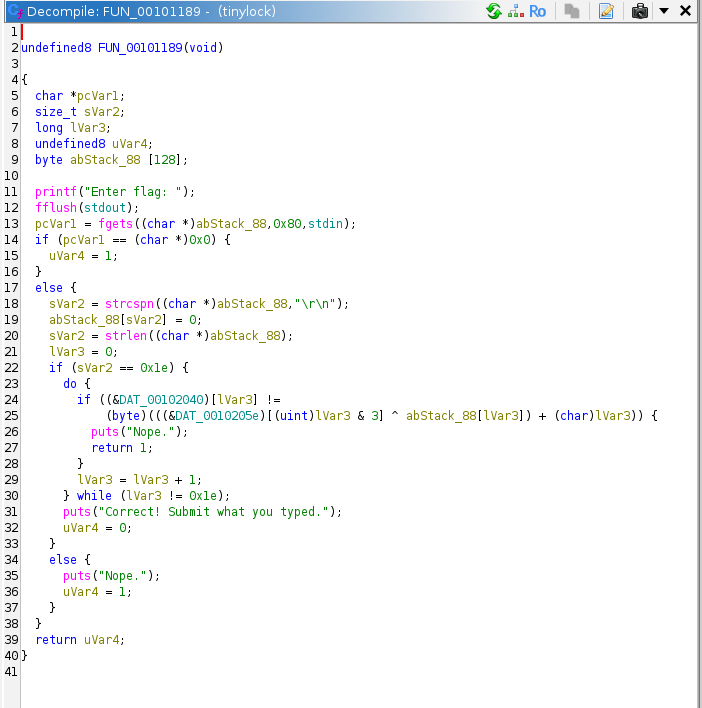
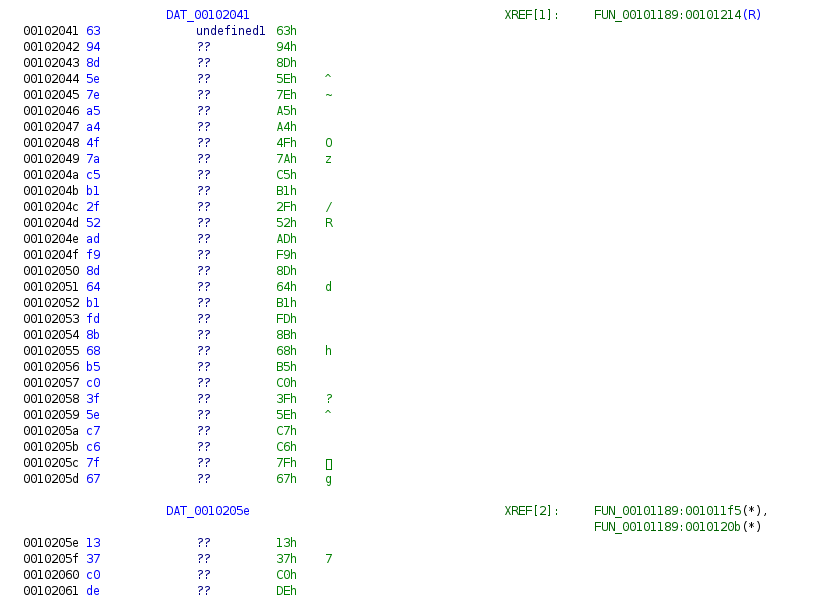
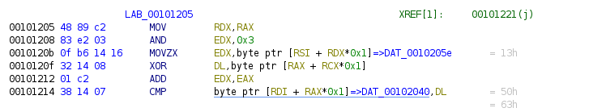
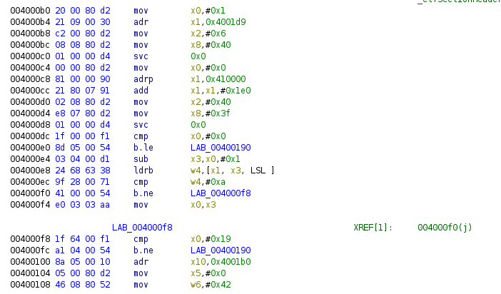
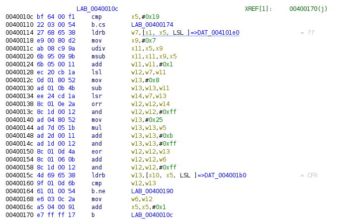
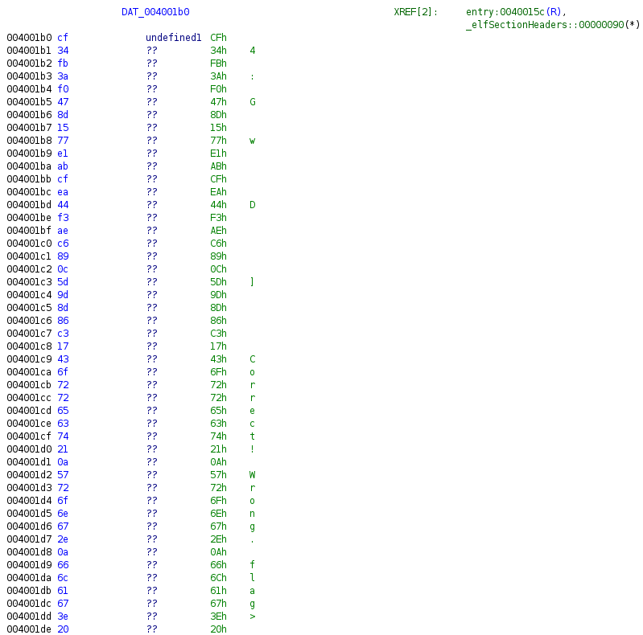
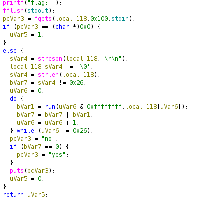
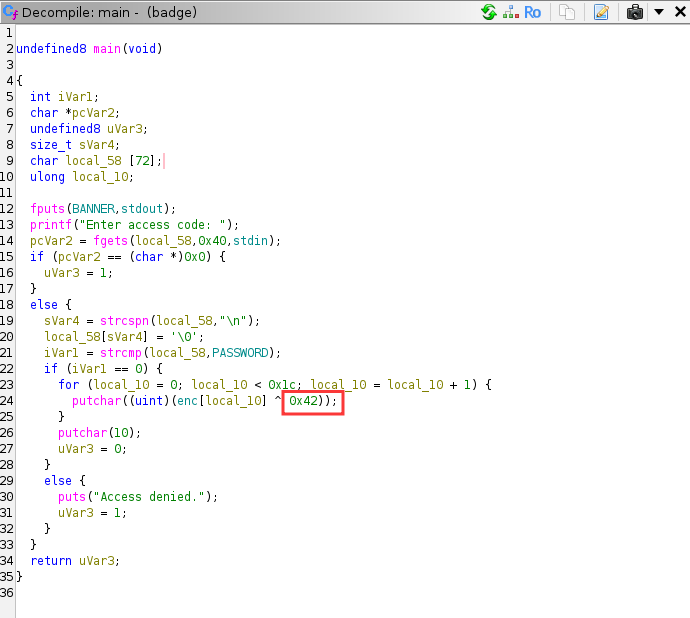
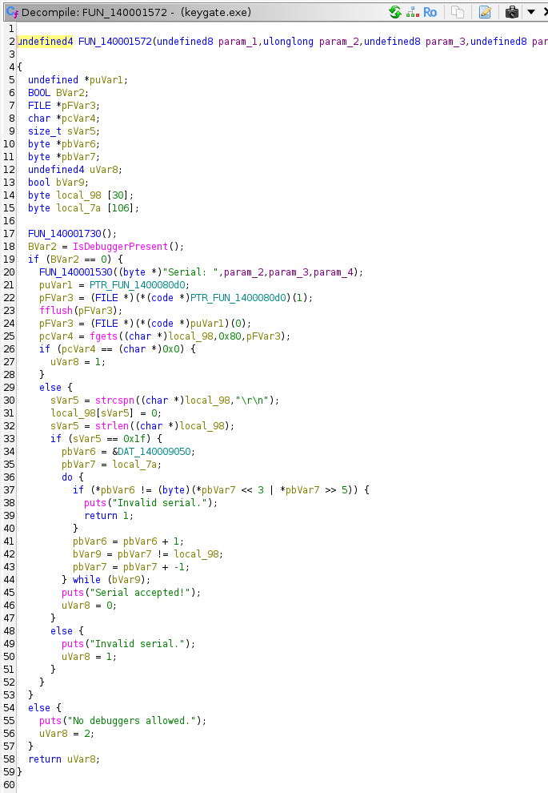

# Reverse problem

下面的是本次2026CTF4(2026.11.21)中解出的reverse题目writeup

## tinylock
检查文件是ELF可执行文件，x86-64；同时导入函数有fgets、strlen、strcspn、printf，程序会读取并检查一行输入。<br>

进入逆向工具分析校验代码：先去掉输入末尾的换行，然后用strlen检查长度必须为0x1e（30bytes）<br>
接着逐字节比较，任一字节不匹配就输出Nope.；全部匹配则输出成功提示。<br>


rsi指向的4个数据字节作为密钥：13 37 C0 DE
rdi指向目标traget数据区，即被下述表达式计算得


```text
target[i] = ((input[i] XOR key[i % 4]) + i) mod 256
```

反推可解原始flag得：
```text
input[i] = ((target[i] - i) mod 256) XOR key[i % 4]
```


## asmaze
检查文件是ELF可执行文件，ARM AArch64架构<br>

进入工具找到entry，可以看到反编译不完整，直接阅读汇编代码。<br>


```C
n = read(0, buffer, 64);
if (n <= 0)
    fail();

if (buffer[n - 1] == '\n')
    n--;

if (n != 25)
    fail();
```

找到字节的校验公式：
```text
r     = (i % 7) + 1
k     = (0x25 * i + 0x0b) & 0xff
value = (ROL8(input[i], r) XOR k + previous) & 0xff
```


然后可以看到接续的data，共只找25字节，剩余的是程序用的字符串


然后逆转运算可得flag
```text
x = ((t[i] - v[i-1]) & 0xff) XOR k
c[i] = ROR8(x, r)
v[i] = t[i]
```

## droidvault
检查文件是Android APK，在`classes.dex`中找到`com.curtin.droidvault.MainActivity`。<br>
导入`classes.dex`，定位`check(String)`方法，并查看类初始化方法`<clinit>`，可以看到校验用的VAULT数组，共32个整数。<br>

阅读`check`方法的Dalvik指令：程序先比较输入长度与数组长度，再循环读取输入字符。每个字符经过异或运算后与`VAULT[i]`对应元素比较；任意一位不匹配就返回失败，全部匹配则返回成功。<br>

公式及逆向运算可得flag：
```text
value = input[i] XOR 90 XOR (i AND 15)

input[i] = VAULT[i] XOR 90 XOR (i AND 15)
```

## thousandcuts
检查文件是ELF可执行文件，x86-64<br>
找到main函数，分析逻辑知道先清除了输入缓冲区，如果输入读取失败则返回1程序退出；排除末尾换行后输入需要38字节，校验失败则返回flag校验结果1（True）；若上述都通过则进行逐下标0-37检验，run方法检验下标和对应内容，查看run对应的反汇编代码可知根据index计算操作程序位置，index对应的内容作为操作程序输入，根据各自特定的操作程序判断输入是否符合预期。如果0-37校验全部通过才返回0，程序才输出yes，其余情况均输出no。知道逻辑后写脚本逐位爆破即可<br>


## wasmgate
题目给了一个WebAssembly文件和一个index.html。先看index.html知道它把输入写进WebAssembly的memory，再调用check(256, 字节长度)<br>
所以关键在于WebAssembly文件里，分析逻辑知道：程序首先判断输入长度是不是28，不是返回错误；设置初始化state=92，如果判断通过，对每一个字节进行操作
```python
value = ((input[i] * 7 + i) & 255) XOR memory[i % 5] XOR state

if value != memory[16 + i]:
    error

state = value
```

如果全部匹配则成功。所以本题的关键在于反算，由于memory已经存放了校验用的数据：前5byte是循环使用的key，offset16开始的28byte是目标序列。<br>
易知7 mod 256的逆元是183，反算公式为：
```python
input[i] = (((target[i] XOR key[i % 5] XOR state) - i) * 183) & 255

state = target[i]
```

最后把输出结果传回check验证即可得到flag

## speedrun
检查文件是ELF x86-64可执行文件。程序要求在2秒内回答150轮，每轮显示一种编码后的字符串，并要求输入解码后的原文。分析主逻辑可见，程序用fgets读取答案，通过strcmp比较答案，并在每轮设置alarm(2)限时。<br>
并且可以看到4种编码：HEX->十六进制解码，REV->反转字符串，ROT13->ROT13解码，B64->Base64解码<br>
脚本思路主要是
    - 快速读取内容：子进程管道，并识别“>”
    - 快速解析题目所要求的编码和对应的字符串：正则提取，快速计算
    - 快速输入：stdin+flush

## all safe badge
检查文件是ELF x86-64可执行文件。strings可以看到可读字符串，结合题目提示看到疑似门禁码候选项m1n1t3l。<br>
接着进行逆向分析，知道程序读取输入、去掉换行，再与 PASSWORD 比较。正确输入后，它会把一段数据逐字节与 0x42 做 XOR，再打印结果。<br>
选择直接去找那段数据进行异或即可知道结果<br>


运气好选项：直接执行该文件，输入m1n1t3l即可得到flag

## keygate
检查文件是PE32+ x86-64可执行文件<br>
阅读主逻辑知道：要求序列号长度是0x1F(31byte)，校验循环对输入字符执行：循环左移3位（rol al, 3），再和程序里藏着的字节逐个比较。比较时从输入末尾往前走，所以把藏着的字节右移3位还原后，再倒序，就得到序列号。<br>
直接找到藏着的字节，即主逻辑的34行对应的DATA
```python
decoded = bytes(((b >> 3) | ((b << 5) & 0xFF)) for b in data)[::-1]
```



## flutter vault
这是一个android apk文件，因为题目使用Flutter，Dart代码经过AOT编译后放在lib/arm64-v8a/libapp.so中，所以重点分析这个文件。<br>
用AOTopsy查看libapp.so的ARM64汇编，看到校验函数逻辑：先检查flag的前缀为CURTIN_CTF{、后缀为}，并要求中间部分长度为 22 字节。<br>
校验逻辑先用初始值0x1337生成LCG字节流，再对输入逐字节异或；之后从第二个字节开始，把前一个变换结果的3倍加到当前字节上。最后按(i * 5) mod 22的顺序与常量表比较。常量从Dart snapshot中提取。

```python
state = 0x1337
state = (state * 0x41c64e6d + 0x3039) & 0x7fffffff
x[i] = input[i] XOR ((state >> 16) & 0xff)

y[0] = x[0]
y[i] = (x[i] + 3 * y[i - 1]) mod 256

table[i] = y[(i * 5) mod 22]
```

因此将常量表按校验时的索引顺序还原，再逆序撤销递推和异或，即可得到flag中间部分：
```python
y[(i * 5) mod 22] = table[i]
x[0] = y[0]
x[i] = (y[i] - 3 * y[i - 1]) mod 256
input[i] = x[i] XOR ((state >> 16) & 0xff)
```

## bolt hole
Android APK，包名为com.bolthole.vault。用Ghidra分析DEX字节码中的校验和解密逻辑：从APK中提取classes3.dex、classes4.dex，导入 Ghidra后按类名定位以下方法：
    - `com.bolthole.vault.security.PinEvaluator.validate(String)`：检查输入 PIN。
    - `com.bolthole.vault.security.VaultCipher.releasePayload(Context, String)`：用 PIN 解密资源中的数据。
    - `com.bolthole.vault.MainActivity.onCreate$lambda$0(...)`：确认界面提交的 PIN 会传给上述方法。

在PinEvaluator.<clinit>中可以看到校验数组<br>
```text
CHECKSUM = [184, 20, 129, 94, 50, 28]
```

validate要求输入为6位数字，并逐位执行以下计算，其中i是从0开始的位置，d是该位数字：<br>
```text
((d * 17 + 43) XOR (i * 29 + 11)) AND 255
```

计算结果需要与CHECKSUM[i]相等。逐位求解得到PIN 819125<br>
VaultCipher.releasePayload从APK资源数组config_telemetry_masks读取掩码。可以使用apktool解码APK并查看该资源<br>
因此先计算PIN的SHA-256 abstract，再逐字节异或还原数据<br>
```text
plain[i] = mask[i] XOR SHA256(UTF8(PIN))[i mod 32] XOR ((i * 13 + 7) AND 255)
```
再用PIN解密得到一串base64编码字符串，解码可得flag

## darkarmydropper
检查文件是x86-64 ELF，在strings中可以看到dropper key、payload sealed提示<br>

接着，程序计算输入key的SHA-256，并与.rodata中保存的摘要比较。比较失败时输出payload sealed。这个校验只控制是否进入解码分支，解码所需的数据和参数仍可从文件中静态提取。<br>

校验通过后，程序从.data的地址0x4060读取37字节密文，以0x1337为初始状态生成LCG字节流，并逐字节XOR。其中state每轮先更新，再取高位字节参与 XOR：<br>
```text
state = (state * 0x41c64e6d + 0x3039) mod 2^32
plain[i] = cipher[i] XOR ((state >> 16) AND 0xff)
```

## notenest
看到逻辑在classes2.dex里面，展开`com.notenest -> DiagnosticsActivity`，看到`<clinit>`、`decodeHex`和`onCreate`。
    - 读取`<clinit>`。它构建ENCODED_KEYS五根base64弦的阵列。把它们复制出来，用base64解码来获取资源名称（sync_batch_token等等）。
    - 读取`onCreate`。反编译器或列表显示循环：对每个键进行base64解码，调用getIdentifier（name， “string”， pkg）， 再调用getString，然后decodeHex，然后附加结果。
    - 读取`decodeHex`。它每次两个字符逐步处理字符串，调用`parseInt（...， 16）`， 并将每个结果映射为一个字符。

取出五个value，按数组给出的顺序，逐个十六进制解码并将它们连接起来即可获得flag
